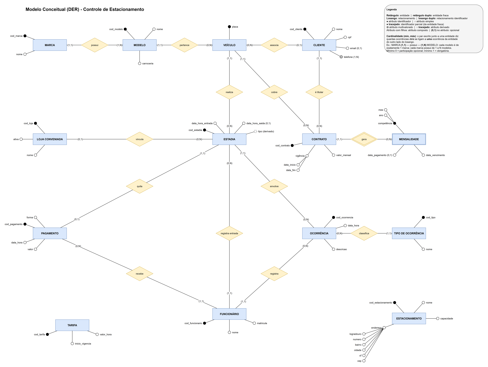
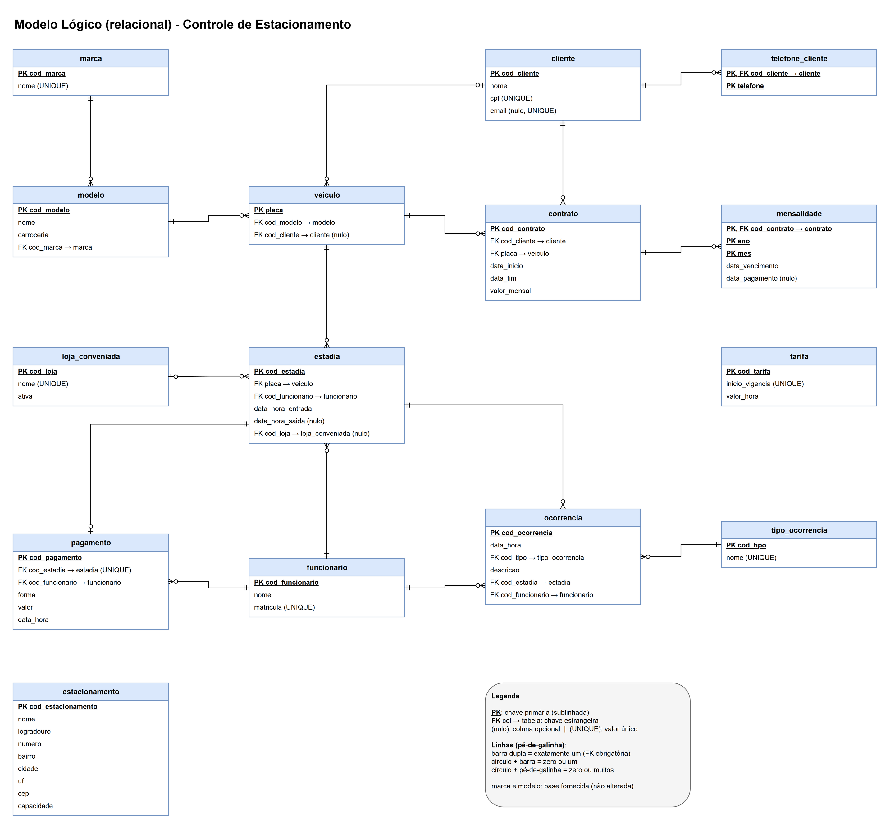

# Banco de Dados para Controle de Estacionamento

Projeto A3 da UC **Modelagem de Software** (2026/2, Butantã). Professor: Marcelo Amorim.

## Integrantes

| RA | Nome completo |
|---|---|
| 826173689 | Yan Pansanato de Campos |

## O que o banco faz

Este é o banco de dados, em **SQLite**, de um estacionamento com uma única unidade e capacidade para 80 carros. O estacionamento atende dois tipos de cliente:

- **avulsos (rotativos)**, cobrados por hora. A fração de hora conta como hora cheia, e vale a tarifa vigente na data da entrada;
- **mensalistas**, com contrato de vigência definida e mensalidades por competência.

O banco registra:

- veículos (placa e modelo da base fornecida), clientes e funcionários;
- entradas e saídas (estadias);
- tarifas com histórico de vigência;
- pagamentos (dinheiro, débito, crédito ou PIX);
- lojas conveniadas vinculadas às estadias;
- ocorrências.

Com ele é possível saber, entre outras coisas, quem está dentro agora, quantas vagas estão livres, quanto cada estadia deve e se as regras de negócio estão sendo respeitadas. As 17 consultas obrigatórias estão em `sql/03-consultas.sql`.

O projeto não tem interface: é só o banco de dados.

## Estrutura do repositório

```
README.md
LICENSE
docs/
  01-conceitual/   DER (der-conceitual.drawio + .svg/.png) e descrição
  02-logico/       diagrama lógico (.drawio + .svg/.png), esquema relacional, justificativas
  03-fisico/       decisões de tipos, restrições, índices e triggers
  decisoes.md      decisões tomadas onde as regras eram omissas
sql/
  00-base-fornecida.sql   marca e modelo (fornecido pelo professor, sem alterações)
  01-schema.sql           criação das tabelas (modelo físico)
  02-dados.sql            dados de teste (fictícios)
  03-consultas.sql        17 consultas, com o resultado de cada uma em comentário
```

## Como reproduzir o banco

Execute os scripts **nesta ordem**, num banco **novo e vazio**:

1. `sql/00-base-fornecida.sql`
2. `sql/01-schema.sql`
3. `sql/02-dados.sql`
4. `sql/03-consultas.sql` (opcional: só executa as consultas)

### No DB Browser for SQLite

1. **Arquivo → Novo banco de dados** e salve, por exemplo, como `estacionamento.db`. Feche a janela de criação de tabela que abrir, clicando em *Cancelar*.
2. Abra a aba **Executar SQL**.
3. Clique em **Abrir arquivo SQL** (ícone de pasta), selecione `sql/00-base-fornecida.sql` e execute tudo com **F5** (ou Ctrl+Enter).
4. Repita o passo 3 com `sql/01-schema.sql` e depois com `sql/02-dados.sql`.
5. Clique em **Escrever alterações** (Ctrl+S).
6. Para ver as consultas, abra `sql/03-consultas.sql`, posicione o cursor numa consulta e use **Ctrl+E** para executar só a linha atual (ou selecione o trecho e pressione F5).

> Use um banco vazio. O `00-base-fornecida.sql` apaga e recria `marca` e `modelo`, o que falharia se as tabelas do grupo já existissem e referenciassem `modelo`. Já o `01-schema.sql` pode ser executado de novo sem problemas, porque começa apagando as tabelas do grupo.

### Pela linha de comando (sqlite3)

```sh
sqlite3 estacionamento.db ".read sql/00-base-fornecida.sql" ".read sql/01-schema.sql" ".read sql/02-dados.sql"
sqlite3 -box estacionamento.db ".read sql/03-consultas.sql"
```

## Diagramas

**Modelo conceitual (DER)**: [docs/01-conceitual](docs/01-conceitual/README.md)



**Modelo lógico**: [docs/02-logico](docs/02-logico/README.md)



**Modelo físico**: [sql/01-schema.sql](sql/01-schema.sql), com as decisões em [docs/03-fisico](docs/03-fisico/README.md)

## Resumo dos dados de teste

| Dado | Quantidade | Destaques |
|---|---|---|
| Estacionamento | 1 | Capacidade de 80 |
| Funcionários | 3 | |
| Clientes | 5 | 7 telefones |
| Veículos | 15 | 15 modelos de 11 marcas; 7 sem cliente |
| Tarifas | 3 | 01/01/2024 (R$ 10, vigente em 05/03/2024), 01/01/2025 (R$ 12), 01/01/2026 (R$ 15) |
| Contratos | 4 | 3 clientes; o contrato 1 já terminou (2024) |
| Mensalidades | 8 | 5 pagas, 3 pendentes |
| Lojas conveniadas | 3 | A Livraria Página Nova não tem estadias |
| Estadias | 31 | 4 dias; 4 em aberto; 8 de mensalistas; 16 rotativas com fração de hora (ex.: 2h30); 10 vinculadas a lojas |
| Pagamentos | 21 | Um por estadia rotativa encerrada, nas 4 formas |
| Ocorrências | 5 | 4 tipos |

As auditorias (consultas 16 e 17) retornam vazio. O resultado de cada consulta está em comentário logo abaixo dela, em [`sql/03-consultas.sql`](sql/03-consultas.sql).

## Ferramentas

- [SQLite](https://sqlite.org) 3 e [DB Browser for SQLite](https://sqlitebrowser.org)
- [draw.io / diagrams.net](https://www.drawio.com) para os diagramas conceitual e lógico. O enunciado permite outra ferramenta que não o brModelo. Os arquivos `.drawio` abrem em <https://app.diagrams.net>.
- Git e GitHub

## Referências

Nenhum modelo de outro banco foi usado como referência. As tabelas `marca` e `modelo` foram fornecidas pelo professor.

## Licença

- **Código** (scripts SQL): licença MIT. Ver [LICENSE](LICENSE).
- **Dados de teste e documentação**: [CC BY 4.0](https://creativecommons.org/licenses/by/4.0/deed.pt_BR). Todos os dados são fictícios.
- `sql/00-base-fornecida.sql` foi fornecido pelo professor e segue os termos dele.
