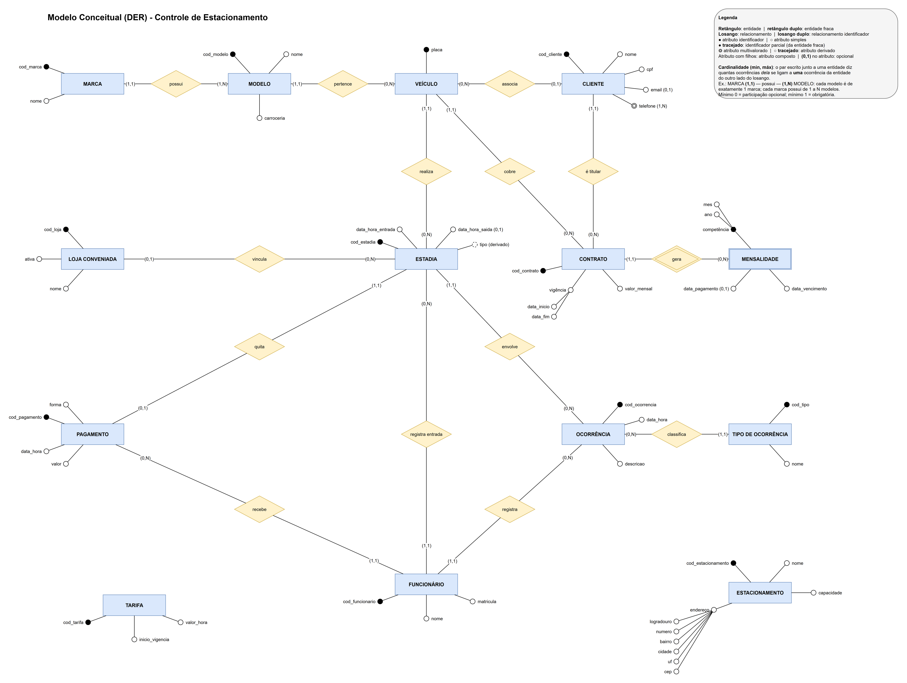

# Modelo conceitual

Este é o diagrama entidade-relacionamento do estacionamento, em notação de Peter Chen (no estilo do brModelo). A legenda e a forma de ler as cardinalidades estão no próprio diagrama.

- Imagem: [der-conceitual.svg](der-conceitual.svg) (também em [PNG](der-conceitual.png))
- Arquivo do projeto (draw.io): [der-conceitual.drawio](der-conceitual.drawio). Abre em <https://app.diagrams.net> ou no draw.io desktop.

## Como ler as cardinalidades

O par **(mín, máx)** escrito ao lado de uma entidade indica quantas ocorrências dessa entidade se ligam a **uma** ocorrência da entidade do outro lado do losango. Mínimo 0 indica participação opcional, e mínimo 1, obrigatória.

Exemplo: `ESTADIA (1,1) — quita — (0,1) PAGAMENTO`. Cada pagamento quita exatamente uma estadia, e cada estadia tem nenhum ou um pagamento.

## Entidades

| Entidade | Atributos | Observações |
|---|---|---|
| MARCA | **cod_marca**, nome | Base fornecida |
| MODELO | **cod_modelo**, nome, carroceria | Base fornecida |
| VEÍCULO | **placa** | RN01 |
| CLIENTE | **cod_cliente**, nome, cpf, email (0,1), telefone (1,N) | `telefone` é multivalorado |
| CONTRATO | **cod_contrato**, vigência (data_inicio, data_fim), valor_mensal | `vigência` é composto (RN12) |
| MENSALIDADE | *competência* (mes, ano), data_vencimento, data_pagamento (0,1) | **Entidade fraca** de CONTRATO; competência é o identificador parcial (RN13) |
| ESTADIA | **cod_estadia**, data_hora_entrada, data_hora_saida (0,1), tipo (derivado) | `tipo` é derivado do contrato vigente (RN07) |
| TARIFA | **cod_tarifa**, inicio_vigencia, valor_hora | Histórico de tarifas (RN09) |
| PAGAMENTO | **cod_pagamento**, forma, valor, data_hora | RN10 |
| LOJA CONVENIADA | **cod_loja**, nome, ativa | RN11 |
| OCORRÊNCIA | **cod_ocorrencia**, data_hora, descricao | RN15 |
| TIPO DE OCORRÊNCIA | **cod_tipo**, nome | Domínio dos tipos (RN15) |
| FUNCIONÁRIO | **cod_funcionario**, nome, matricula | Cadastro simples |
| ESTACIONAMENTO | **cod_estacionamento**, nome, endereço (logradouro, numero, bairro, cidade, uf, cep), capacidade | `endereço` é composto (RN03) |

## Relacionamentos

| Relacionamento | Entidades e cardinalidades | Regra |
|---|---|---|
| possui | MARCA (1,1) — (1,N) MODELO | Base |
| pertence | MODELO (1,1) — (0,N) VEÍCULO | RN01 |
| associa | VEÍCULO (0,N) — (0,1) CLIENTE | RN02 |
| é titular | CLIENTE (1,1) — (0,N) CONTRATO | RN12 |
| cobre | VEÍCULO (1,1) — (0,N) CONTRATO | RN12 (um único veículo por contrato) |
| gera *(identificador)* | CONTRATO (1,1) — (0,N) MENSALIDADE | RN13 |
| realiza | VEÍCULO (1,1) — (0,N) ESTADIA | RN06 |
| registra entrada | FUNCIONÁRIO (1,1) — (0,N) ESTADIA | RN06 |
| vincula | LOJA CONVENIADA (0,1) — (0,N) ESTADIA | RN11 (no máximo uma loja) |
| quita | ESTADIA (1,1) — (0,1) PAGAMENTO | RN10 (um único pagamento) |
| recebe | FUNCIONÁRIO (1,1) — (0,N) PAGAMENTO | RN10 |
| envolve | ESTADIA (1,1) — (0,N) OCORRÊNCIA | RN15 |
| registra | FUNCIONÁRIO (1,1) — (0,N) OCORRÊNCIA | RN15 |
| classifica | TIPO DE OCORRÊNCIA (1,1) — (0,N) OCORRÊNCIA | RN15 |

TARIFA e ESTACIONAMENTO não se relacionam com as outras entidades:

- A tarifa de uma estadia é obtida pela data da entrada (RN08/RN09), sem vínculo armazenado (ver [decisões D11 e D14](../decisoes.md)).
- Existe uma única unidade de estacionamento (D01).

## Regras verificadas por consulta, e não pela estrutura

- **RN04** (vagas livres): capacidade menos as estadias sem saída. Ver consulta 13.
- **RN05** (no máximo uma estadia em aberto por veículo): consulta 16. O físico também a garante com um índice único parcial.
- **RN07** (tipo da estadia): atributo derivado. Ver consulta 15.
- **RN14** (contratos sem sobreposição): consulta 17. O físico também a garante com triggers.
