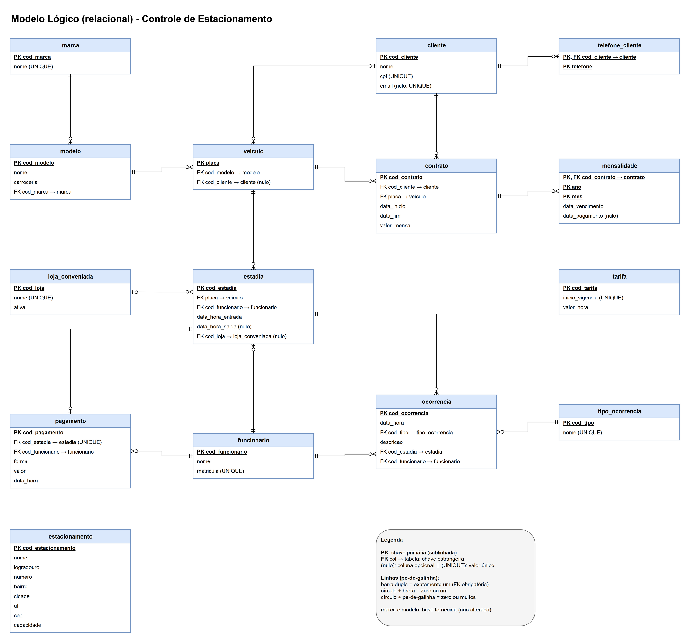

# Modelo lógico

O modelo lógico mostra as tabelas, as chaves primárias e as chaves estrangeiras, normalizadas até a 3FN.

- Imagem: [diagrama-logico.svg](diagrama-logico.svg) (também em [PNG](diagrama-logico.png))
- Arquivo do projeto (draw.io): [diagrama-logico.drawio](diagrama-logico.drawio)



## Esquema relacional

Notação: as chaves primárias estão sublinhadas, `FK → tabela` indica chave estrangeira e `?` marca coluna opcional (aceita nulo).

```
marca            (cod_marca, nome)                                        -- base fornecida
modelo           (cod_modelo, nome, carroceria, cod_marca → marca)        -- base fornecida
estacionamento   (cod_estacionamento, nome, logradouro, numero, bairro, cidade, uf, cep, capacidade)
funcionario      (cod_funcionario, nome, matricula)
cliente          (cod_cliente, nome, cpf, email?)
telefone_cliente (cod_cliente → cliente, telefone)
veiculo          (placa, cod_modelo → modelo, cod_cliente? → cliente)
tarifa           (cod_tarifa, inicio_vigencia, valor_hora)
loja_conveniada  (cod_loja, nome, ativa)
contrato         (cod_contrato, cod_cliente → cliente, placa → veiculo, data_inicio, data_fim, valor_mensal)
mensalidade      (cod_contrato → contrato, ano, mes, data_vencimento, data_pagamento?)
estadia          (cod_estadia, placa → veiculo, cod_funcionario → funcionario,
                  data_hora_entrada, data_hora_saida?, cod_loja? → loja_conveniada)
pagamento        (cod_pagamento, cod_estadia → estadia [UNIQUE], cod_funcionario → funcionario,
                  forma, valor, data_hora)
tipo_ocorrencia  (cod_tipo, nome)
ocorrencia       (cod_ocorrencia, data_hora, cod_tipo → tipo_ocorrencia, descricao,
                  cod_estadia → estadia, cod_funcionario → funcionario)
```

Chaves primárias:

| Tabela | PK |
|---|---|
| telefone_cliente | (cod_cliente, telefone) |
| mensalidade | (cod_contrato, ano, mes) |
| veiculo | placa |
| demais tabelas | `cod_*` simples |

## Tradução do conceitual para o lógico

| No conceitual | No lógico | Justificativa |
|---|---|---|
| MODELO pertence VEÍCULO (1:N) | `veiculo.cod_modelo → modelo` | 1:N: a FK fica no lado N |
| CLIENTE associa VEÍCULO (1:N, opcional do lado do veículo) | `veiculo.cod_cliente → cliente`, aceita nulo | Mínimo 0: a FK é opcional (RN02) |
| CLIENTE é titular CONTRATO (1:N) | `contrato.cod_cliente → cliente` | FK no lado N |
| VEÍCULO cobre CONTRATO (1:N) | `contrato.placa → veiculo` | FK no lado N |
| CONTRATO gera MENSALIDADE (identificador) + entidade fraca | `mensalidade(cod_contrato, ano, mes)` com PK composta | A PK da fraca é a PK do dono mais o identificador parcial |
| Atributo composto *competência* (mês, ano) | Colunas `ano`, `mes` | Valores atômicos (1FN) |
| Atributo composto *vigência* | Colunas `data_inicio`, `data_fim` | 1FN |
| Atributo composto *endereço* | Colunas `logradouro` … `cep` | 1FN |
| Atributo multivalorado *telefone* | Tabela `telefone_cliente(cod_cliente, telefone)` | O multivalorado vira outra tabela |
| VEÍCULO realiza ESTADIA (1:N) | `estadia.placa → veiculo` | FK no lado N |
| FUNCIONÁRIO registra entrada ESTADIA (1:N) | `estadia.cod_funcionario → funcionario` | FK no lado N |
| LOJA vincula ESTADIA (0..1:N) | `estadia.cod_loja → loja_conveniada`, aceita nulo | No máximo uma loja (RN11) |
| ESTADIA quita PAGAMENTO (1:0..1) | `pagamento.cod_estadia → estadia` + **UNIQUE** | 1:1 opcional: a FK fica no lado opcional, com UNIQUE |
| FUNCIONÁRIO recebe PAGAMENTO (1:N) | `pagamento.cod_funcionario → funcionario` | FK no lado N |
| ESTADIA envolve OCORRÊNCIA (1:N) | `ocorrencia.cod_estadia → estadia` | FK no lado N |
| FUNCIONÁRIO registra OCORRÊNCIA (1:N) | `ocorrencia.cod_funcionario → funcionario` | FK no lado N |
| TIPO classifica OCORRÊNCIA (1:N) | `ocorrencia.cod_tipo → tipo_ocorrencia` | FK no lado N |
| Atributo derivado *tipo* da estadia | Não vira coluna, é calculado na consulta 15 | Evita redundância (D12) |
| TARIFA, ESTACIONAMENTO (sem relacionamentos) | Tabelas isoladas | D01, D11 |

O conceitual não tem relacionamentos N:N, então nenhuma tabela associativa foi necessária. A única tabela "extra" é `telefone_cliente`, que vem do atributo multivalorado.

## Normalização

- **1FN**: todas as colunas são atômicas. Os atributos compostos viraram colunas, e o multivalorado virou a tabela `telefone_cliente`.
- **2FN**: as tabelas com PK composta não têm dependência parcial.
  - Em `telefone_cliente`, não há colunas fora da PK.
  - Em `mensalidade`, o vencimento e o pagamento dependem da combinação contrato + competência.
- **3FN**: não há dependências transitivas.
  - A marca do veículo é obtida por `veiculo → modelo → marca`, sem ser repetida em `veiculo`.
  - O valor da mensalidade não é copiado do contrato (D22).
  - O tipo da estadia e o valor devido são derivados e não ficam armazenados (D12, D14).
  - Os nomes dos tipos de ocorrência ficam numa tabela de domínio.
